  

  

---

## Sobre mí

Hola, soy **Loreine**. Soy una estudiante motivada, apasionada por la tecnología, la programación, la innovación y el aprendizaje continuo. Disfruto desarrollar ideas creativas, resolver problemas y participar en proyectos que combinan la tecnología con el diseño.

Soy una persona curiosa, creativa y siempre dispuesta a aprender algo nuevo. Creo que cada proyecto es una oportunidad para crecer, experimentar y convertir ideas en algo significativo.

---

## Habilidades y tecnologías

  
  
  
  

| Habilidad | Descripción |
|---|---|
| **Microsoft Excel** | Certificación oficial y habilidades en el manejo de hojas de cálculo. |
| **Python** | Nivel principiante: ciclos, condicionales, operadores y resolución lógica de problemas. |
| **Inglés** | Buen dominio del idioma y habilidades de comunicación. |
| **GitHub** | Gestión de repositorios, documentación de proyectos y aprendizaje continuo. |
| **Diseño de proyectos** | Pensamiento creativo, diseño visual y desarrollo colaborativo. |
| **Habilidades blandas** | Pensamiento analítico, adaptabilidad, trabajo en equipo y resolución de problemas. |

---

## Proyectos y experiencia

| Proyecto | Descripción |
|---|---|
| **BioWill** | Participé en el diseño del proyecto, aportando ideas creativas y apoyando su desarrollo. |
| **Proyectos en Python** | Practico los fundamentos de programación y desarrollo mis habilidades de codificación. |
| **Aprendizaje continuo** | Amplío mis conocimientos técnicos mediante certificaciones oficiales y aprendizaje autónomo. |

---

## Objetivos actuales

- Fortalecer mis habilidades de programación en Python.
- Explorar el análisis de datos y la tecnología.
- Crear un portafolio de proyectos prácticos.
- Seguir desarrollando mis habilidades técnicas y comunicativas.

---

## Juega un momento

  

---

## Estadísticas de GitHub

  
  

<b>Aprendiendo hoy, construyendo el mañana.</b>

